<div align="center">

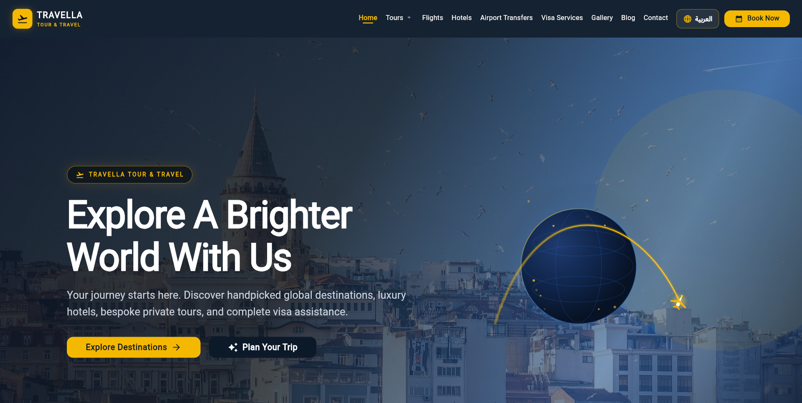

<br/>
<br/>

# ✈️ Travella — Tour & Travel

### *Explore A Brighter World With Us*

A full-featured, production-ready travel agency web application built with **Flutter** & **Supabase** — offering tours, flights, hotels, visa services, airport transfers, and Hajj & Umrah packages, backed by a powerful admin CMS.

<br/>

[](https://flutter.dev)
[](https://dart.dev)
[](https://supabase.com)
[](https://bloclibrary.dev)
[](LICENSE)

</div>

---

## 🌟 Overview

**Travella** is a fully functional, multi-platform travel agency platform with a sleek public website and a comprehensive admin CMS — all powered by Flutter Web and Supabase. Customers can browse destinations, book tours, request visas, find hotels, arrange airport transfers, and book Hajj & Umrah packages — while admins manage everything from a polished dashboard.

---

## 📸 Public Website

### 🏠 Hero — Explore A Brighter World


<br/>

### 🌍 World Destinations — Explore Extraordinary Places
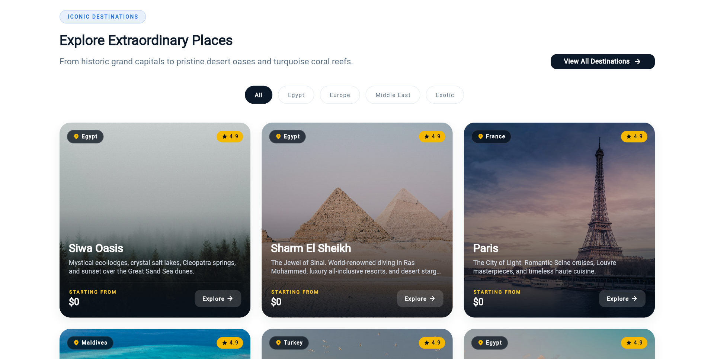

<br/>

### 🇪🇬 Domestic Tours — Egypt's Timeless Wonders
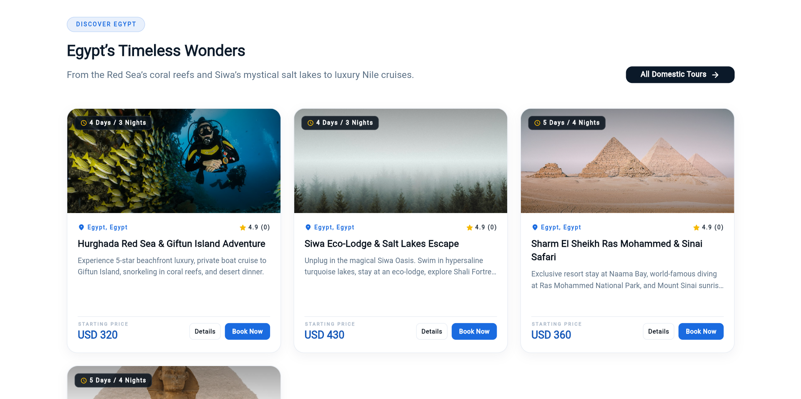

<br/>

### 🗺️ International Tours — Travel Beyond Borders
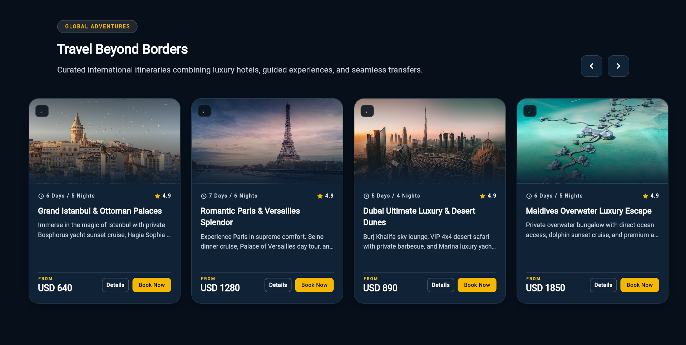

<br/>

### ✈️ Flights — World-Class Flights & Bespoke Routes
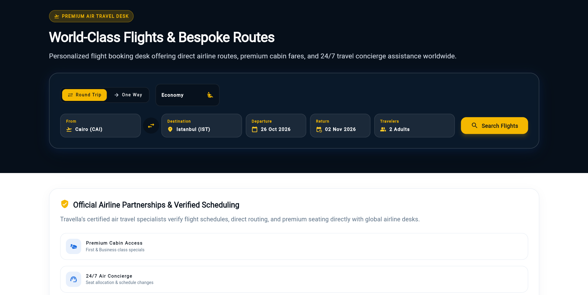

<br/>

### 🏨 Hotels — Stay Somewhere Amazing
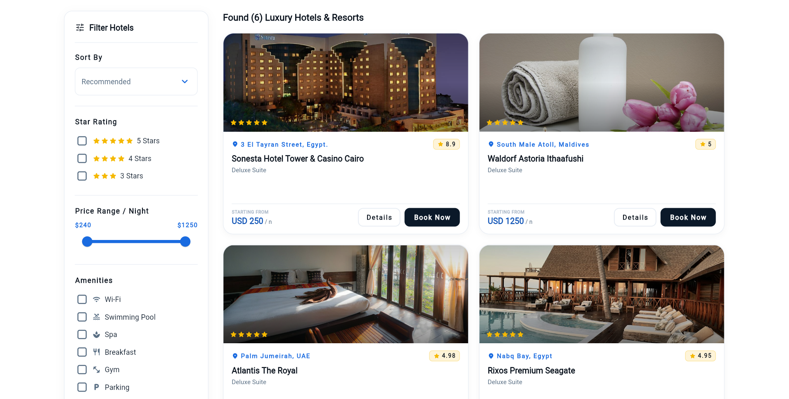

<br/>

### 🚗 Airport Transfers — Seamless Airport & Luxury Private Transfers
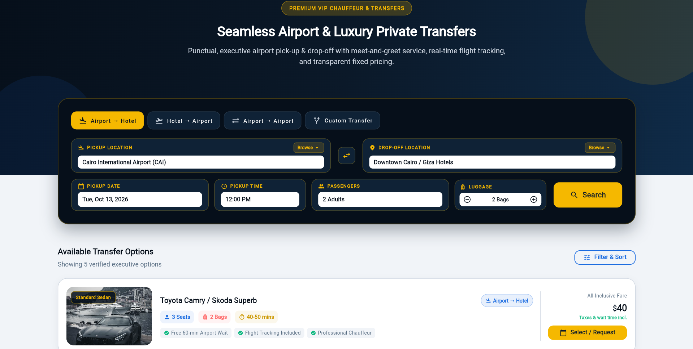

<br/>

### 🛂 Visa Services — Fast-Track Visa Consultation
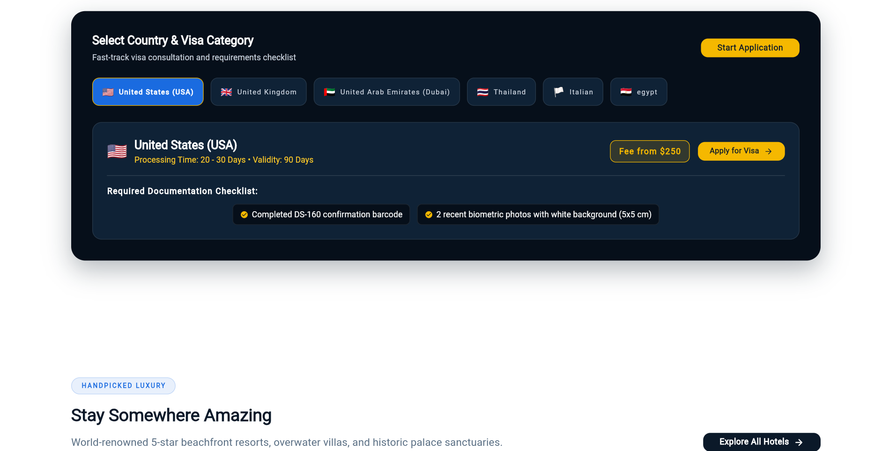

<br/>

### 🕌 Hajj & Umrah — Spiritual Journeys, Carefully Arranged
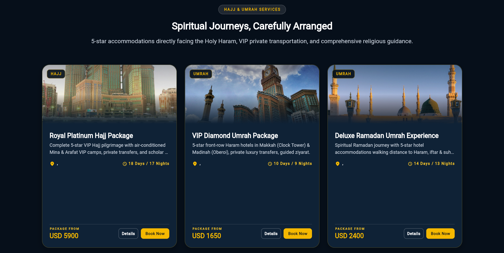

<br/>

### 📞 Contact — Submit a Travel Inquiry
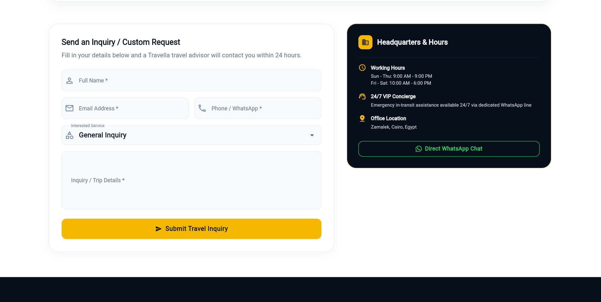

---

## 🖥️ Admin CMS

### 🔐 Admin Login — Secure Role-Protected Portal
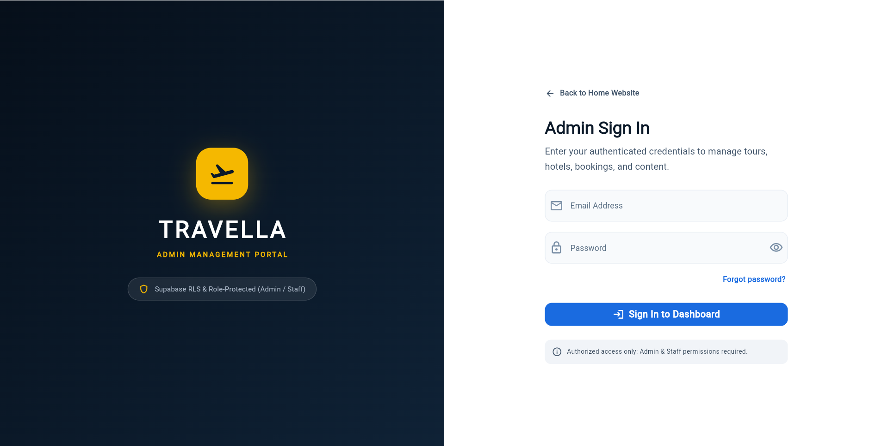

<br/>

### 📊 Admin Dashboard — Full Overview at a Glance
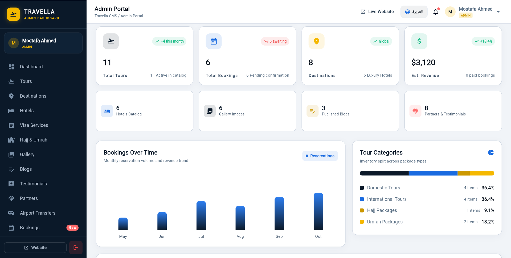

<br/>

### 🗺️ Tour Management — Create, Edit & Publish Packages
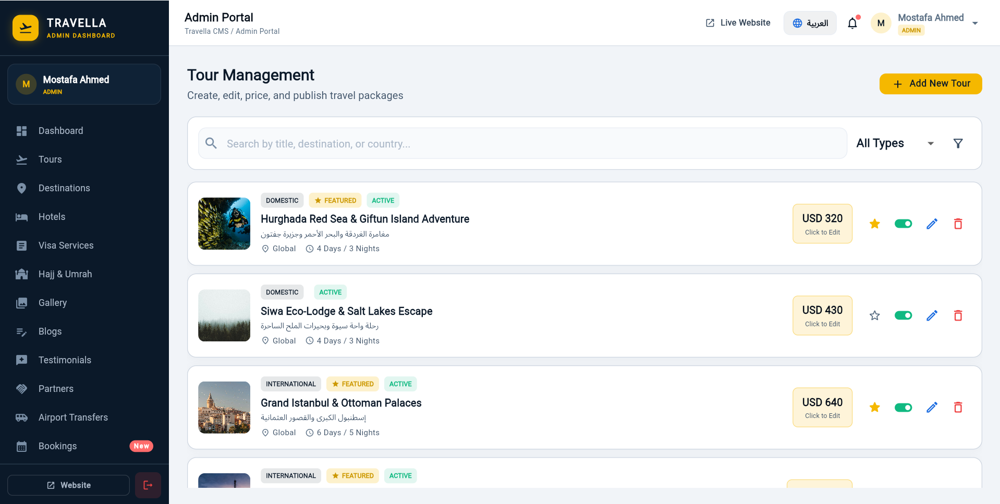

<br/>

### 🛂 Visa Applications — Review & Update Application Status
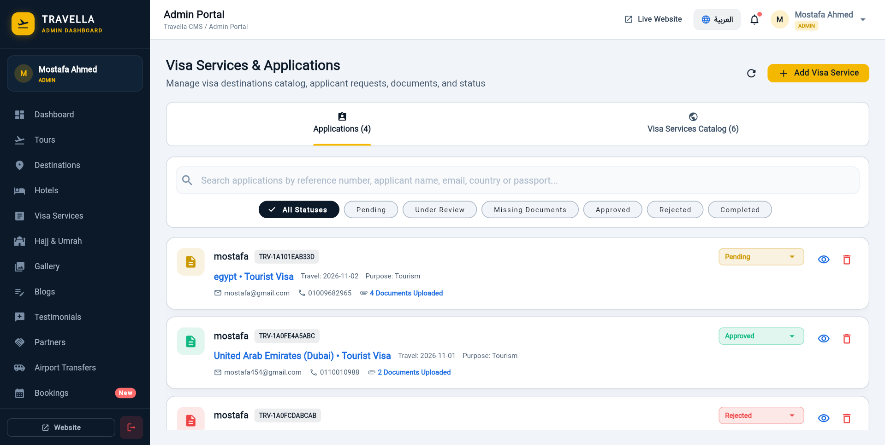

<br/>

### 📋 Visa Application Details — Full Applicant Profile & Documents
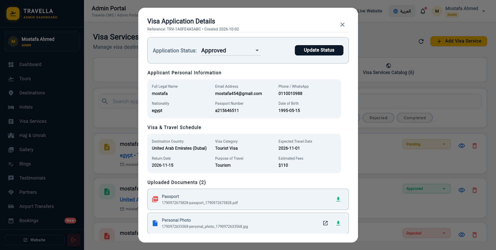

<br/>

### 🌐 Visa Services Catalog — Manage Country Visa Listings
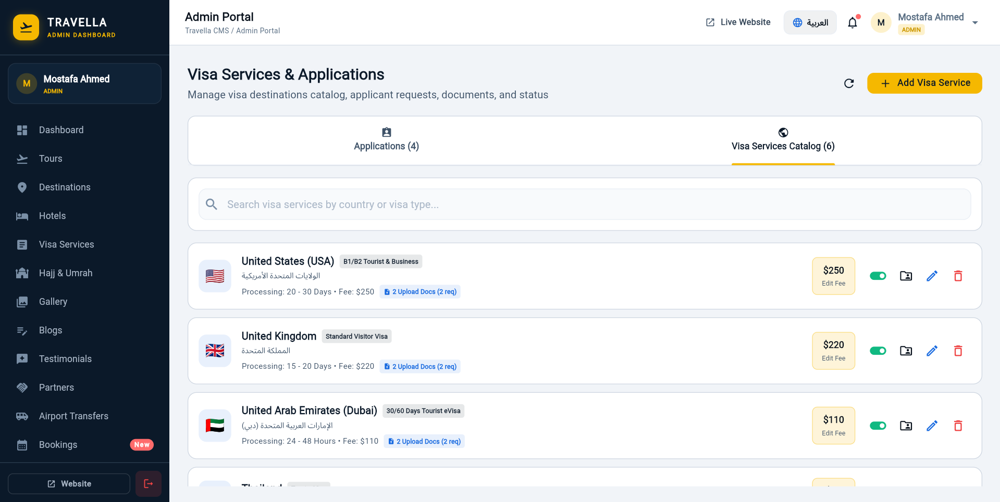

<br/>

### 🕌 Hajj & Umrah Packages — Spiritual Package Management
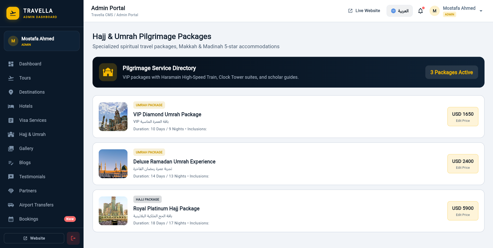

<br/>

### 🖼️ Media Gallery — Supabase Storage Management
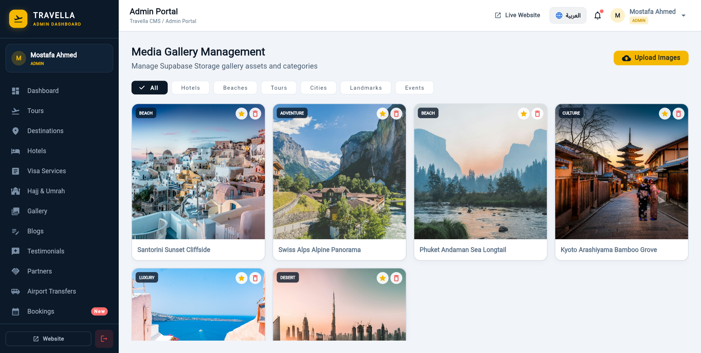

<br/>

### 🚗 Airport Transfers Fleet — Vehicle & Pricing Management
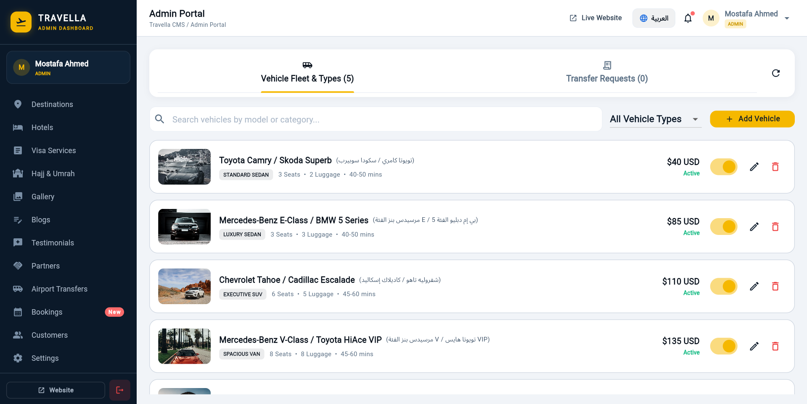

<br/>

### 📅 Bookings & Inquiries — Review Client Reservations
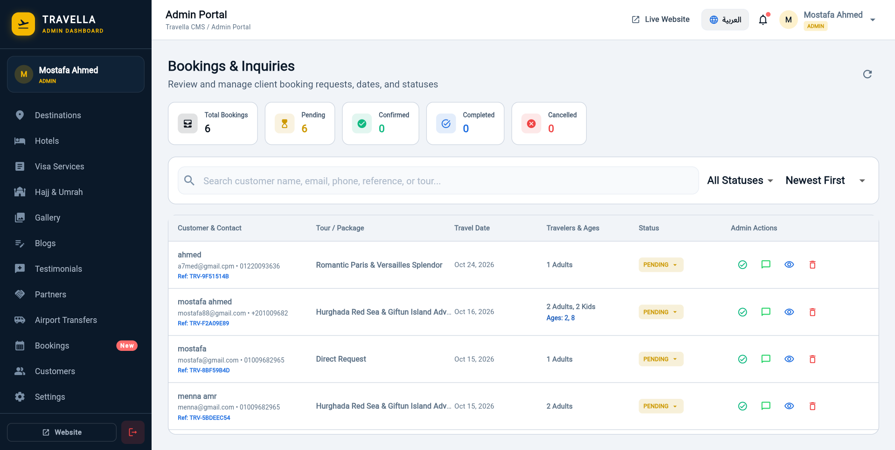

<br/>

### 🔍 Booking Details — Full Record, Status & Quick Actions
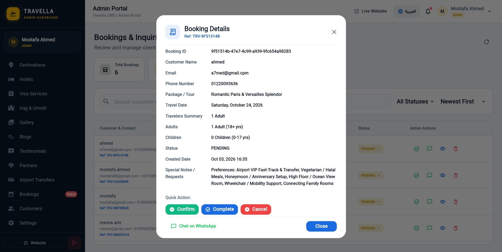

---

## ✨ Features

### 🌐 Public Website

| Feature | Description |
|---|---|
| 🏠 **Home** | Animated hero section, featured destinations, popular tours, testimonials, partner logos |
| 🌍 **Destinations** | Browsable world destinations with search & category filter (Egypt, Europe, Middle East, Asia, Exotic) |
| 🗺️ **International Tours** | Curated global packages with duration, ratings, search & sort |
| 🇪🇬 **Domestic Tours** | Egypt-specific tour packages |
| ✈️ **Flights** | Flight inquiry form with Round-Trip/One-Way, cabin class, date & passenger selection |
| 🏨 **Hotels** | Hotel listings with search, star rating & amenity filtering |
| 🚗 **Airport Transfers** | VIP chauffeur booking — Airport→Hotel, Hotel→Airport, Airport→Airport, Custom |
| 🛂 **Visa Services** | Visa application assistance with country selection & documentation checklist |
| 🕌 **Hajj & Umrah** | Premium spiritual pilgrimage packages with Hajj & Umrah tabs |
| 🖼️ **Gallery** | Photo gallery of destinations and tours |
| 📰 **Blog** | Travel articles and destination guides |
| 📞 **Contact** | Inquiry form with WhatsApp integration and office information |
| 📋 **Booking** | Complete booking system for tours with traveler details |

### 🔐 Admin CMS

| Feature | Description |
|---|---|
| 🔑 **Auth** | Supabase-powered login with role-based access control (Admin / Staff) |
| 📊 **Dashboard** | Live stats for tours, bookings, destinations, revenue, gallery & blog |
| 🗺️ **Tours** | Create, edit, price, feature & publish domestic/international packages |
| 📍 **Destinations** | Manage world destination catalog |
| 🏨 **Hotels** | Hotel listings management |
| 🛂 **Visa Services** | Manage visa catalog + review applicant submissions with status updates |
| 🕌 **Hajj & Umrah** | Manage pilgrimage package catalog |
| 🖼️ **Gallery** | Upload & categorize media assets via Supabase Storage |
| 📰 **Blogs** | Create and manage travel articles |
| 🚗 **Airport Transfers** | Manage vehicle fleet and handle transfer requests |
| 📅 **Bookings** | Review, confirm, complete or cancel customer bookings with WhatsApp chat |
| 👥 **Customers** | Customer directory management |
| ⚙️ **Settings** | Dynamic site configuration |

---

## 🏗️ Architecture

```
lib/
├── core/
│   ├── animations/        # Reusable animation utilities
│   ├── constants/         # App-wide constants
│   ├── localization/      # i18n — Arabic & English (RTL/LTR)
│   ├── responsive/        # Responsive layout helpers
│   ├── routing/           # GoRouter + Auth Guard
│   ├── theme/             # Light & dark theme tokens
│   ├── utils/             # Helper utilities
│   └── widgets/           # Shared widgets
│
├── data/
│   ├── repositories/      # Data layer (14 repositories)
│   └── services/          # Supabase service initialization
│
├── features/              # Feature-first structure (17 features)
│   ├── home/
│   ├── destinations/
│   ├── tours/ & domestic_tours/ & international_tours/
│   ├── flights/
│   ├── hotels/
│   ├── airport_transfers/
│   ├── visa_services/
│   ├── hajj_umrah/
│   ├── gallery/
│   ├── blogs/
│   ├── bookings/
│   ├── contact/
│   ├── auth/
│   ├── site_settings/
│   └── admin/
│
└── shared/                # Shared models and widgets
```

Each feature follows **Clean Architecture** with:
- `presentation/` — Widgets, Pages, Cubits
- `domain/` — Use cases and entities
- `data/` — Repository implementations

---

## 🛠️ Tech Stack

| Category | Technology |
|---|---|
| **Framework** | Flutter 3.x (Web, Windows, macOS, Linux, Android, iOS) |
| **Language** | Dart 3.x |
| **Backend** | Supabase (Auth, Database, Storage) |
| **State Management** | flutter_bloc / Cubit |
| **Navigation** | go_router with Auth Guard |
| **Localization** | flutter_localizations (Arabic 🇸🇦 & English 🇬🇧, RTL/LTR) |
| **UI Animations** | animate_do, lottie, shimmer, visibility_detector |
| **Image Handling** | cached_network_image |
| **Icons** | font_awesome_flutter, flutter_svg, cupertino_icons |
| **Fonts** | google_fonts |
| **Code Generation** | freezed, json_serializable, build_runner |
| **Reactive Streams** | rxdart |
| **HTTP** | http, supabase_flutter |

---

## 🚀 Getting Started

### Prerequisites

- [Flutter SDK](https://flutter.dev/docs/get-started/install) `^3.11.5`
- [Dart SDK](https://dart.dev/get-dart) `^3.x`
- A [Supabase](https://supabase.com) project

### Installation

1. **Clone the repository**
   ```bash
   git clone https://github.com/your-username/travella.git
   cd travella
   ```

2. **Install dependencies**
   ```bash
   flutter pub get
   ```

3. **Configure Supabase**

   Update your Supabase credentials in `lib/data/services/supabase_service.dart`:
   ```dart
   const supabaseUrl = 'YOUR_SUPABASE_URL';
   const supabaseAnonKey = 'YOUR_SUPABASE_ANON_KEY';
   ```

4. **Run code generation** (for Freezed models)
   ```bash
   dart run build_runner build --delete-conflicting-outputs
   ```

5. **Run the app**
   ```bash
   # Web (Chrome)
   flutter run -d chrome

   # Windows Desktop
   flutter run -d windows
   ```

---

## 🌍 Localization

The app supports **Arabic** 🇸🇦 and **English** 🇬🇧 with full RTL/LTR layout switching. Users can toggle language from the navigation bar at any time.

---

## 📁 Database Schema

| Table | Purpose |
|---|---|
| `destinations` | World destinations data |
| `tours` | Tour packages (domestic & international) |
| `hotels` | Hotel listings |
| `visa_services` | Visa service packages |
| `hajj_umrah_packages` | Hajj & Umrah packages |
| `airport_transfers` | Transfer vehicle options |
| `bookings` | Customer booking records |
| `gallery` | Photo gallery items |
| `blog_posts` | Travel articles |
| `testimonials` | Customer reviews |
| `partners` | Partner company logos |
| `site_settings` | Dynamic site configuration |
| `users` *(Supabase Auth)* | Role-based user accounts |

---

## 🔒 Role-Based Access Control

| Role | Access |
|---|---|
| **Guest** | All public pages |
| **User** | Public pages + Booking |
| **Admin / Staff** | Full admin dashboard + all management modules |

---

## 📦 Project Info

| Property | Value |
|---|---|
| **App Name** | Travella — Tour & Travel |
| **Version** | 1.0.0+1 |
| **Platforms** | Web, Windows, macOS, Linux, Android, iOS |
| **Min SDK** | Dart `^3.11.5` |

---

<div align="center">

Made with ❤️ using Flutter & Supabase

</div>
