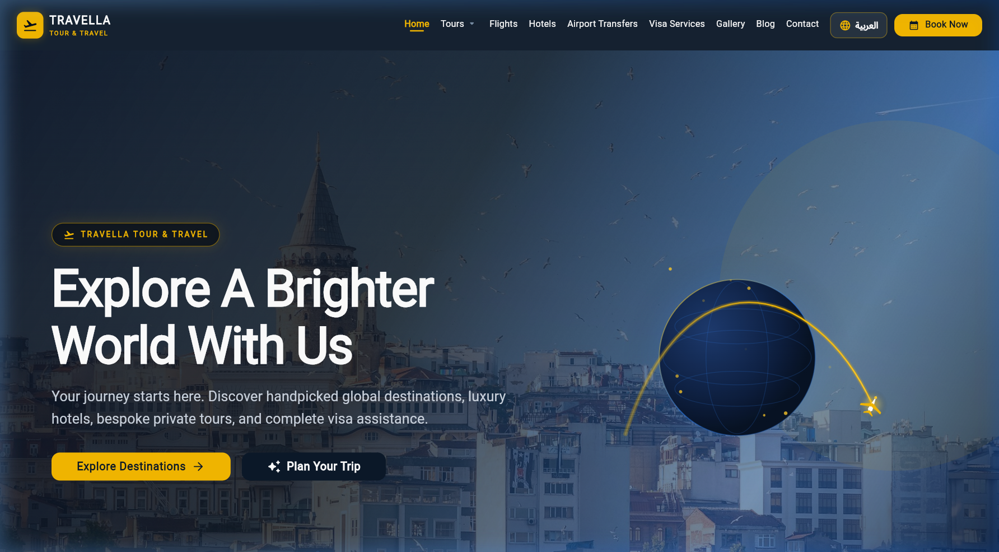
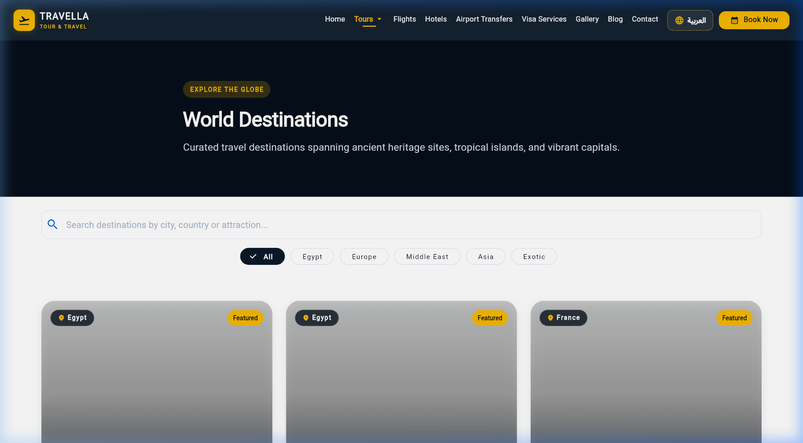
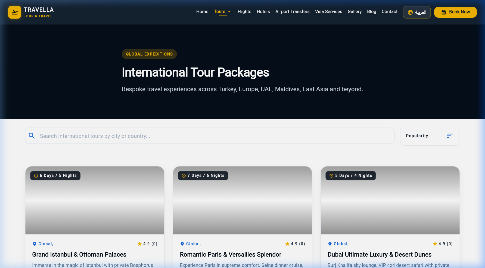
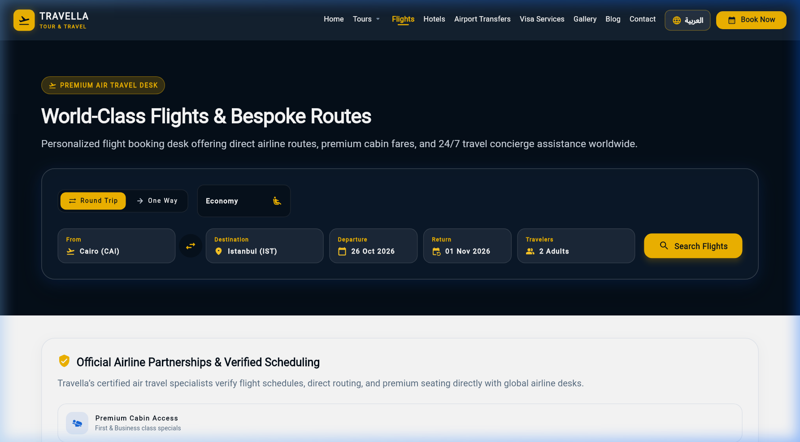
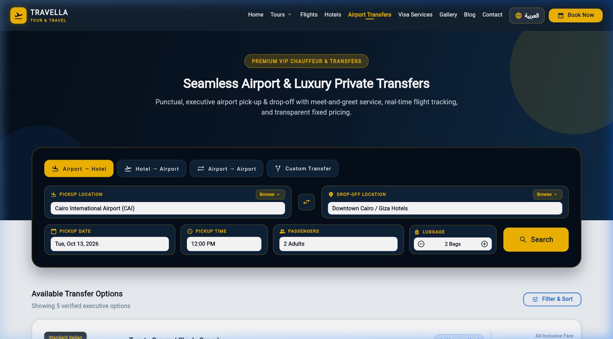
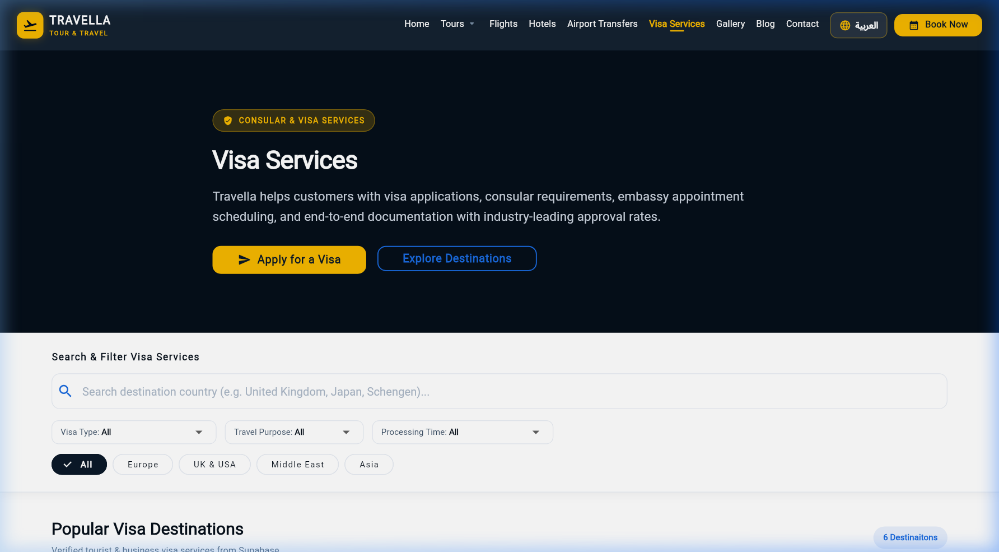
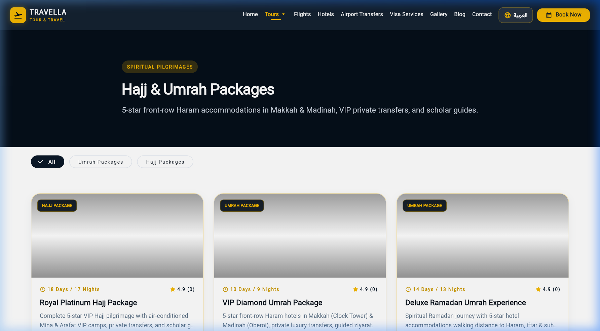
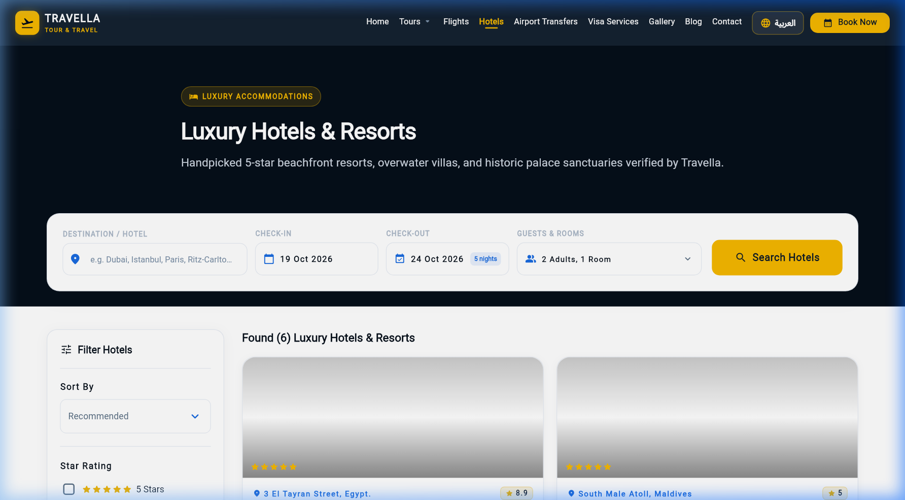
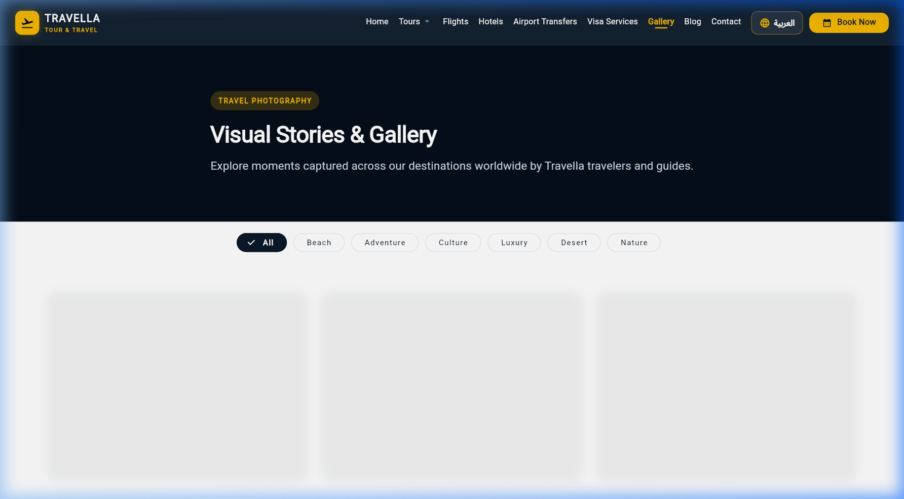
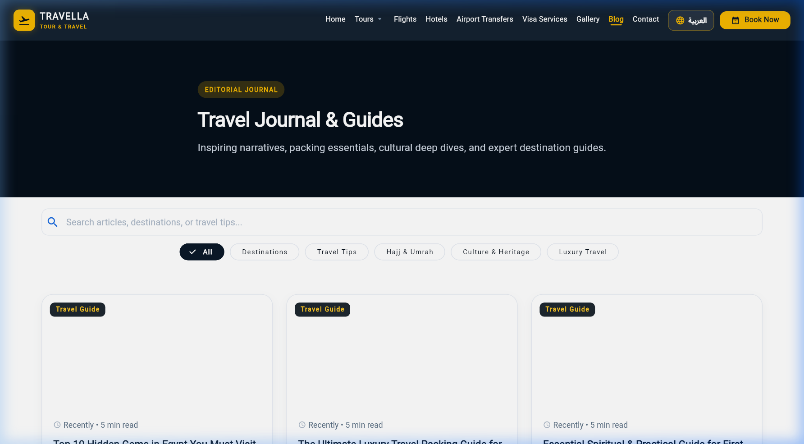

<div align="center">

# ✈️ Travella — Tour & Travel

### *Explore A Brighter World*

A full-featured travel agency web application built with **Flutter** & **Supabase** — offering tours, flights, hotels, visa services, airport transfers, and Hajj & Umrah packages.

[](https://flutter.dev)
[](https://dart.dev)
[](https://supabase.com)
[](https://bloclibrary.dev)

</div>

---

## 📸 Screenshots

### 🏠 Home Page


### 🌍 World Destinations


### 🗺️ International Tour Packages


### ✈️ Flights Booking


### 🚗 Airport Transfers


### 🛂 Visa Services


### 🕌 Hajj & Umrah Packages


### 🏨 Hotels


### 🖼️ Gallery


### 📰 Blog


---

## ✨ Features

### 🌐 Public Pages

| Feature | Description |
|---|---|
| 🏠 **Home** | Animated hero section, featured destinations, popular tours, testimonials, partner logos |
| 🌍 **Destinations** | Browsable world destinations with search & category filter (Egypt, Europe, Middle East, Asia, Exotic) |
| 🗺️ **International Tours** | Curated global packages with duration, ratings, search & sort |
| 🇪🇬 **Domestic Tours** | Egypt-specific tour packages |
| ✈️ **Flights** | Flight inquiry form with Round-Trip/One-Way, cabin class, date & passenger selection |
| 🏨 **Hotels** | Hotel listings with search & filtering |
| 🚗 **Airport Transfers** | VIP chauffeur booking — Airport→Hotel, Hotel→Airport, Airport→Airport, Custom |
| 🛂 **Visa Services** | Visa application assistance with type, purpose & processing time filters |
| 🕌 **Hajj & Umrah** | Premium spiritual pilgrimage packages with Hajj & Umrah tabs |
| 🖼️ **Gallery** | Photo gallery of destinations and tours |
| 📰 **Blog** | Travel articles and destination guides |
| 📞 **Contact** | Contact form and company information |
| 📋 **Booking** | Complete booking system for tours |

### 🔐 Authentication & Admin

| Feature | Description |
|---|---|
| 🔑 **Auth** | Supabase-powered login with role-based access control |
| 📊 **Admin Dashboard** | Full admin panel for managing all content |
| 🗂️ **Admin Modules** | Tours, Destinations, Hotels, Visa, Hajj/Umrah, Gallery, Blog, Testimonials, Partners, Transfers, Bookings, Customers, Settings |

---

## 🏗️ Architecture

```
lib/
├── core/
│   ├── animations/        # Reusable animation utilities
│   ├── constants/         # App-wide constants
│   ├── localization/      # i18n — Arabic & English (RTL/LTR)
│   ├── responsive/        # Responsive layout helpers
│   ├── routing/           # GoRouter + Auth Guard
│   ├── theme/             # Light & dark theme tokens
│   ├── utils/             # Helper utilities
│   └── widgets/           # Shared widgets
│
├── data/
│   ├── repositories/      # Data layer (14 repositories)
│   └── services/          # Supabase service initialization
│
├── features/              # Feature-first structure (17 features)
│   ├── home/
│   ├── destinations/
│   ├── tours/ & domestic_tours/ & international_tours/
│   ├── flights/
│   ├── hotels/
│   ├── airport_transfers/
│   ├── visa_services/
│   ├── hajj_umrah/
│   ├── gallery/
│   ├── blogs/
│   ├── bookings/
│   ├── contact/
│   ├── auth/
│   ├── site_settings/
│   └── admin/
│
└── shared/                # Shared models and widgets
```

Each feature follows **Clean Architecture** with:
- `presentation/` — Widgets, Pages, Cubits
- `domain/` — Use cases and entities
- `data/` — Repository implementations

---

## 🛠️ Tech Stack

| Category | Technology |
|---|---|
| **Framework** | Flutter 3.x (Web, Windows, macOS, Linux, Android, iOS) |
| **Language** | Dart 3.x |
| **Backend** | Supabase (Auth, Database, Storage) |
| **State Management** | flutter_bloc / Cubit |
| **Navigation** | go_router with Auth Guard |
| **Localization** | flutter_localizations (Arabic 🇸🇦 & English 🇬🇧, RTL/LTR) |
| **UI Animations** | animate_do, lottie, shimmer, visibility_detector |
| **Image Handling** | cached_network_image |
| **Icons** | font_awesome_flutter, flutter_svg, cupertino_icons |
| **Fonts** | google_fonts |
| **Code Generation** | freezed, json_serializable, build_runner |
| **Reactive Streams** | rxdart |
| **HTTP** | http, supabase_flutter |

---

## 🚀 Getting Started

### Prerequisites

- [Flutter SDK](https://flutter.dev/docs/get-started/install) `^3.11.5`
- [Dart SDK](https://dart.dev/get-dart) `^3.x`
- A [Supabase](https://supabase.com) project

### Installation

1. **Clone the repository**
   ```bash
   git clone https://github.com/your-username/travella.git
   cd travella
   ```

2. **Install dependencies**
   ```bash
   flutter pub get
   ```

3. **Configure Supabase**

   Update your Supabase credentials in `lib/data/services/supabase_service.dart`:
   ```dart
   const supabaseUrl = 'YOUR_SUPABASE_URL';
   const supabaseAnonKey = 'YOUR_SUPABASE_ANON_KEY';
   ```

4. **Run code generation** (for Freezed models)
   ```bash
   dart run build_runner build --delete-conflicting-outputs
   ```

5. **Run the app**
   ```bash
   # Web (Chrome)
   flutter run -d chrome

   # Windows Desktop
   flutter run -d windows
   ```

---

## 🌍 Localization

The app supports **Arabic** 🇸🇦 and **English** 🇬🇧 with full RTL/LTR layout switching. Users can toggle language from the navigation bar at any time.

---

## 📁 Database Schema

The app connects to Supabase with the following main tables:

| Table | Purpose |
|---|---|
| `destinations` | World destinations data |
| `tours` | Tour packages (domestic & international) |
| `hotels` | Hotel listings |
| `visa_services` | Visa service packages |
| `hajj_umrah_packages` | Hajj & Umrah packages |
| `airport_transfers` | Transfer vehicle options |
| `bookings` | Customer booking records |
| `gallery` | Photo gallery items |
| `blog_posts` | Travel articles |
| `testimonials` | Customer reviews |
| `partners` | Partner company logos |
| `site_settings` | Dynamic site configuration |
| `users` *(Supabase Auth)* | Role-based user accounts |

---

## 🔒 Role-Based Access Control

| Role | Access |
|---|---|
| **Guest** | All public pages |
| **User** | Public pages + Booking |
| **Admin** | Full admin dashboard + all management modules |

---

## 📦 Project Info

| Property | Value |
|---|---|
| **App Name** | Travella — Tour & Travel |
| **Version** | 1.0.0+1 |
| **Platforms** | Web, Windows, macOS, Linux, Android, iOS |
| **Min SDK** | Dart `^3.11.5` |

---

<div align="center">

Made with ❤️ using Flutter & Supabase

</div>
